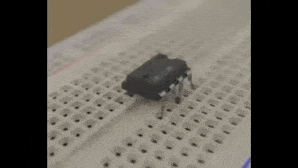

<h1 align="center">
  
</h1>

<h3 align="center">Grade 11 student in Brampton, Ontario 🍁</h3>

  
  
  
  

### About me

- Embedded firmware with the Pico SDK (RP2040), ESP-IDF (ESP32-C3), and Arduino
- Computer vision with OpenCV, PyTorch, and YOLO
- Summer 2026 intern at Railway Academy, where I built a railway object-detection app around a custom ResNet18 classifier
- PCEP-certified Python programmer
- I post electronics tutorials on [YouTube](https://www.youtube.com/@abhiram-s.electronics)

### Projects

| Project | What it does | Result |
|---|---|---|
| [CaptainGemma](https://github.com/AbhiramV010/CaptainGemma) | Gemma captains a Cessna 172 in JSBSim through a PID autopilot while an Arduino mirrors the plane's attitude on a physical model | 1st, Best Use of Open Source AI, HT6 Hack Day 2026 |
| [Halo](https://github.com/AbhiramV010/Halo_JecHacks26) | Context-aware Electron app that teaches concepts by drawing on your screen | 2nd place, JecHacks 2026 |
| [AutoVision](https://github.com/AbhiramV010/AutoVision) | Voice-controlled robot arm and turntable that photographs an object from several angles for Gemini to analyze | 3rd place, Hack the Valley Hack Day 2026 |
| [Iris-Lite](https://github.com/AbhiramV010/Iris-Lite) | Edge camera that filters events on-device to cut storage and power use | Shown at STEAM ICAC 2026 |
| [CaughtLackin](https://github.com/AbhiramV010/CaughtLackin) | Android study app that catches you slacking and texts your friends about it | |
| [MCU-Datalogger](https://github.com/AbhiramV010/MCU-Datalogger) | Custom datalogger PCB designed in KiCad | In progress |

### Tools

  

  

  
  
  

Currently learning C++ and PCB layout.

  

